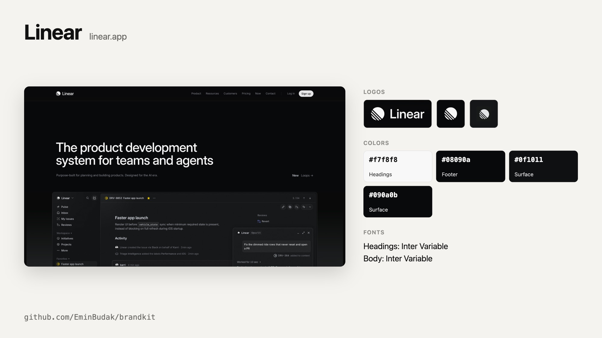
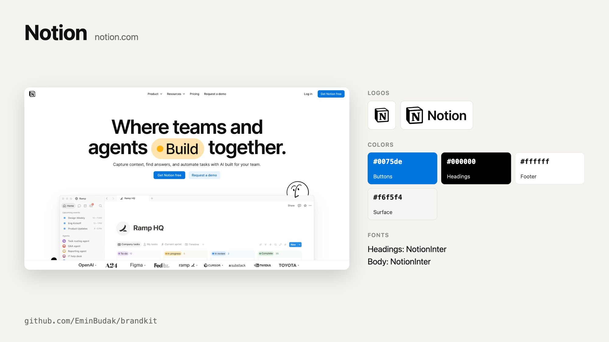
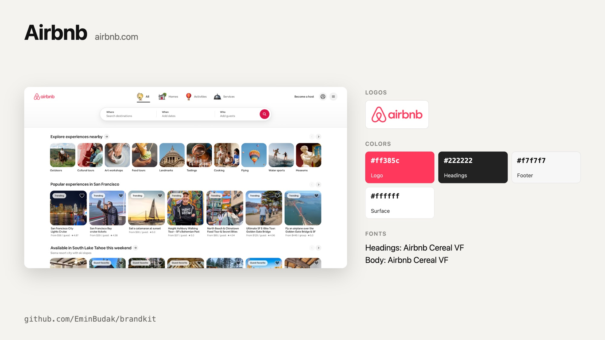

# easybrandkit

Get a website's real logo files, colors, fonts and first screen, saved as a brand kit your coding agent can read.

```bash
npx easybrandkit linear.app
```



Ask a coding agent for a landing page, a launch video or a pitch deck for a product and it guesses: a blue that is almost right, a logo retyped in Inter. easybrandkit opens the real site in a headless browser, finds the logos the site itself draws, cuts each one out on the background it sits on, and writes down the colors and fonts the page actually uses. Your agent reads one Markdown file and works from facts.

Read the story behind it on my blog: [easybrandkit: A Brand Kit for Coding Agents](https://eminbudak.com/blog/easybrandkit-brand-kit-for-coding-agents/).

## What you get

```
easybrandkit-linear.app/
  BRAND.md               the kit, for people and agents
  brand.json             the same, for scripts
  card.png               the kit on one picture, like the one above
  logo-01.png            the header logo, on its real background
  logo-02.png            the footer logo
  screen-01.png          the first screen at 2x, without the cookie bar
  appstore-icon.png      the app icon at 1024 px, when the site links to its app
  appstore-shot-01.png   and up to five store screenshots
  x-profile.jpg          the profile pictures of the accounts it links to
```

- **Logos** come from the header, the footer and links to the home page, as the browser paints them: SVG, image or CSS. Partner strips, customer logos, payment badges and closed menus are skipped. Each cut is at least 240 px on its short side and has no transparency, so it can go straight into an image model or a video.
- **Colors** are the solid colors of the site's buttons, headings, text links, header, footer and large surfaces, plus the color the logo itself is drawn in. Tints, grey buttons and white language switches do not count.
- **Fonts** are the families the page uses for headings and body text.
- **Words**: the page title and description, its headings in reading order and what its buttons say, so copy can start from the product's own words instead of made-up claims.
- **App stores and profiles**: when the site links to its App Store or Google Play listing, easybrandkit saves the app icon at 1024 px and up to five screenshots. Linked X, YouTube and LinkedIn accounts give their profile pictures.
- **Icons, preview images, the web manifest and social links** are listed with their URLs.

| | |
| --- | --- |
|  |  |

## Use it with your agent

easybrandkit ships as an [Agent Skill](https://agentskills.io). Install it once and your agent runs it by itself when you ask for something for a product:

```bash
npx skills add EminBudak/easybrandkit
```

That covers Claude Code, Codex, Cursor and the other agents the [`skills`](https://github.com/vercel-labs/skills) CLI supports. In Claude Code you can add it as a plugin instead:

```
/plugin marketplace add EminBudak/easybrandkit
/plugin install easybrandkit@easybrandkit
```

Then ask as usual:

> Make a 30 second launch video for linear.app

The skill carries its own script, so it installs nothing else and needs no API key.

## Use it from the command line

```
npx easybrandkit <url> [options]

  --out <dir>      where to save (default: ./easybrandkit-<host>)
  --no-stores      skip app store listings and social profiles
  --json           print brand.json instead of a summary
  --timeout <s>    give up after this many seconds (default: 120)
```

The address can be a website or an App Store or Google Play listing. A listing gives the app icon and screenshots, and the brand is read from the website the listing names. A social profile is not a brand's site, so easybrandkit refuses one and asks for the website.

Installed globally (`npm install -g easybrandkit`), the command is `easybrandkit`.

It needs Node 22 or newer and Chrome, Chromium, Edge or Brave. Set `CHROME_PATH` to pick the browser. There are no npm dependencies and nothing is downloaded: easybrandkit drives the browser you already have over the Chrome DevTools Protocol, with a throwaway profile.

## How it works

1. Opens the home page in a headless browser on a 1600x900 desktop screen. An address deeper in the site is read from the home page, because a blog or a help center often wears another theme.
2. Scrolls to the bottom and back, so lazy sections and footer logos load.
3. Reads one DOM snapshot with layout and computed styles. Logo candidates are images, outermost SVGs and elements named "logo" or "brand". They are kept only in the page header, in the page footer, inside a link to the home page, or when they are named after the brand.
4. Brings each logo to the middle of the screen, finishes its fade-in, hides whatever paints over it (a popup backdrop, the next line of text) and cuts it out with a margin of its own background.
5. Hides floating overlays and takes the first screen at 2x.
6. Fetches store listings and profile pictures over HTTPS from a fixed list of hosts, and refuses private addresses.

## Limits

- A site that answers with a bot check or a login wall gets no kit: easybrandkit stops and says so, instead of saving the check page's colors.
- Instagram, Facebook and TikTok serve nothing without a login, so they are not asked.
- A logo drawn into a canvas or a WebGL scene is not found.
- Colors come from what the home page shows. A main color used on one button of another page will not show up.

## License

MIT
